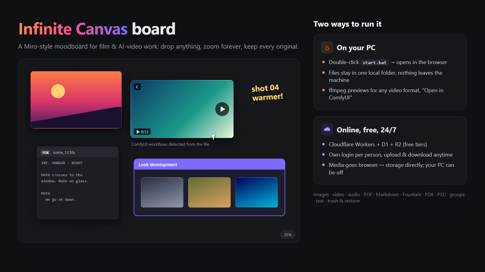

# Infinite Canvas

**A Miro-style moodboard for film and AI-video work.** Drop in images, video, audio, scripts and PDFs, then pan and zoom
across one endless board. Every original is kept byte-for-byte. Text notes and coloured groups help you lay out shots,
looks and references. ComfyUI workflows are detected inside your files.

**How to make it live (free, 24/7, step by step):** [emberlamp.com/infinite-canvas.html](https://emberlamp.com/infinite-canvas.html)



## Two ways to run it

| | **On your PC** | **Online (free, 24/7)** |
|---|---|---|
| Start | double-click `start.bat` → opens `http://127.0.0.1:5180` | deploy `cloud/` to Cloudflare Workers once |
| Data | one local folder (`data/`), nothing leaves the machine | Cloudflare D1 (board) + R2 (media), free tiers |
| Who | you | several people, each with their own login |
| Video previews | ffmpeg converts any format | made in the browser (formats the browser can't play show as a file card) |
| Extras | Show in folder, Open in ComfyUI | Copy workflow, works with your PC off |

- **PC:** see *Requirements* and *Start* below.
- **Online:** step-by-step guide at [emberlamp.com/infinite-canvas.html](https://emberlamp.com/infinite-canvas.html), commands in [`cloud/README.md`](cloud/README.md). In short: create an R2 bucket, `npx wrangler login`, `npm run db:init`,
  set the secrets (users from `cloud/scripts/hash-password.mjs`, S3 keys, session secret), then `npm run deploy`. Media goes
  straight from the browser to R2 through signed links, so the Worker stays inside the free 10 ms CPU budget.

## Features
- Infinite pan / zoom canvas, drop / paste / pick files, multi-select, resize, undo / redo, several boards, autosave.
- Every image and video format: shown directly or converted to a preview (originals are always kept byte-for-byte).
- Viewer (Enter): full-screen image / video with frame stepping, info card.
- Audio cards with waveform, PDF / Word-type previews, text / Markdown / Fountain / FDX documents with edit + versions.
- **Text** items: right-click > Text, typed straight onto the board (transparent, multi-line). Size S / M / L / XL, 5 colours, bold, alignment
  from a small floating toolbar. Resize handles change the box width (text wraps); Shift + corner scales the font.
- **Group** frames like ComfyUI groups: right-click > Group wraps the selected items (bounding box + 24 px + title bar), or a 600x400 frame at the
  click point. Rename by double-clicking the title, 5 colour dots in the title bar. Dragging the title moves the group and everything fully
  inside it (nested groups too); dragging inside the body is a normal marquee. Groups always render behind items. (Comments were removed from
  the UI on 2026-11-23; the server tables and routes are still there.)
- Info card (source, codec, size ...). Source detection: ComfyUI, Higgsfield, ChatGPT, other C2PA generators, Unknown.
- **ComfyUI items** carry a round "C" badge (lower-right, constant size, hidden under 60 px on screen, tooltip "Made in ComfyUI").
  Right-click > **Open in ComfyUI** saves the embedded workflow into ComfyUI (Workflows > Board), copies it to the clipboard
  and opens ComfyUI in a new tab. ComfyUI is never started by the board.
- **Trash**: deleted items are kept 30 days. Board name menu > Trash (n): Restore or Delete forever.
- **Show in folder** selects the stored original in Explorer (Windows, only from the machine running the server).

## Requirements (Windows 11)
```
winget install OpenJS.NodeJS.LTS          # Node 22 or newer
winget install Gyan.FFmpeg                # ffmpeg + ffprobe on PATH (open a NEW terminal afterwards)
```
Optional: LibreOffice (DOCX / ODT / RTF previews). If ffmpeg is not on PATH set `FFMPEG_PATH` / `FFPROBE_PATH` in `.env`.

## Start
Double-click `start.bat`. First run: `npm install` (web + server), build, start the server on `127.0.0.1:5180`, open
http://localhost:5180. Later runs only rebuild when sources changed. If the board is already running it just opens the browser.

## Settings (`.env`, optional - copy `.env.example`; every key is optional)
| Key | Default | Meaning |
|---|---|---|
| `DATA_DIR` | `.\data` | where everything is stored (`board.sqlite`, `originals\`, `previews\`, `thumbs\`, `versions\`, `tmp\`) |
| `PORT` | `5180` | port the server listens on |
| `HOST` | `127.0.0.1` | interface; `0.0.0.0` for a server / tunnel (only with `APP_PASSWORD`) |
| `TRUST_PROXY` | off | `true` / hop count / proxy IPs when behind cloudflared / Caddy (real client IPs, https detection) |
| `APP_PASSWORD` | empty | set = login required for every page and `/api` route (except `/login`, `/api/health`); empty = no login |
| `STORAGE_DRIVER` | `local` | `local` (files in `DATA_DIR`) or `s3` (Cloudflare R2, direct browser transfers) |
| `S3_ENDPOINT`, `S3_BUCKET`, `S3_ACCESS_KEY_ID`, `S3_SECRET_ACCESS_KEY`, `S3_REGION` | - / `auto` | bucket access, required with `s3` |
| `PRESIGN_TTL_S` | `3600` | lifetime of presigned media links |
| `FFMPEG_PATH`, `FFPROBE_PATH` | on PATH | only when ffmpeg / ffprobe are elsewhere |
| `SOFFICE_PATH` | auto-detected | LibreOffice, for Office document previews |
| `MAX_FILE_GB` | `5` | largest accepted upload |
| `COMFYUI_URL` | `http://127.0.0.1:8188` | ComfyUI used by "Open in ComfyUI" |

## Hosting online
Same code, `.env` decides: default = local, no password, files on disk. Online = `APP_PASSWORD` + `STORAGE_DRIVER=s3`; videos and other
big files then travel browser <-> R2 directly and never pass through the server or a Cloudflare tunnel. Full steps (R2 bucket, API token,
CORS, cloudflared tunnel, VPS with systemd or Docker, migration script): **`docs\HOSTING.md`**.

R2 bucket CORS (Settings > CORS Policy; replace the origin with the board's address):
```json
[
  {
    "AllowedOrigins": ["https://board.example.com"],
    "AllowedMethods": ["GET", "HEAD", "PUT"],
    "AllowedHeaders": ["*"],
    "ExposeHeaders": ["ETag", "Content-Length", "Content-Range", "Accept-Ranges"],
    "MaxAgeSeconds": 3600
  }
]
```
Files: `deployoard.service`, `deploy\Dockerfile`, `deploy\docker-compose.yml`, `scripts\migrate-local-to-r2.mjs` (`--dry-run`).

## Mouse and keyboard
| Input | Action |
|---|---|
| Wheel / Ctrl+wheel | zoom toward the cursor (2% .. 3200%), the page itself never scrolls or zooms |
| Middle-drag, Space + left-drag | pan |
| Left click | select (Shift / Ctrl+click toggles); empty click deselects; drag on empty space = marquee |
| Click on a video / audio item | play / pause (short delay so a double click does not toggle it) |
| Double-click an image / video | toggle real size (100% pixels, centered) and back |
| Drag item / handles | move / resize (aspect locked, Shift = free; a multi-selection scales as a group). Text: handles change the width, Shift + corner scales the font. Group: title drag moves it with its contents, handles resize only the frame |
| Right-click | context menu (below) |
| Enter | open the selected item in the Viewer |
| Left / Right | step one frame of the selected video (Shift = 10 frames); audio seeks 1 s (Shift = 5 s). In the Viewer: previous / next item (video: frames) |
| I | info card for the selection (also in the Viewer; a group shows its title and item count, a text its length and size) |
| Double-click a text item, Enter on a selected text | edit the text in place (Esc or click outside commits; empty text deletes the item) |
| Double-click a group title | rename the group (Enter / Esc / click away commits) |
| Ctrl+D | duplicate the selection |
| Delete / Backspace | delete selection (goes to Trash) |
| Ctrl+Z, Ctrl+Shift+Z / Ctrl+Y | undo, redo |
| Ctrl+A, Shift+1 (fit all), Shift+0 (100%) | select all, camera |
| Ctrl+V | paste an image / files at the cursor |
| Esc | close menu, then info card, then clear selection |
| Viewer: F, M, L | video fullscreen, mute, loop |

Context menu on an item: Text, Group, Open (Enter), Download original, Show in folder (local only), Open in ComfyUI (ComfyUI items only),
Bring to front, Send to back, Delete. On empty space: Text, Group, Upload here, Paste (reads clipboard images; for files use Ctrl+V or drag),
Fit all.

## Where the data lives / backup
Everything is in `DATA_DIR`. The database stores only paths relative to it.
**Backup = stop the server and copy the `DATA_DIR` folder.** Moving it = copy the folder and point `DATA_DIR` at the new place.
Deleted items stay in the database 30 days (checked at server start and every 6 h); then the item and (if no other item
uses it) the media files are removed.

## Dev mode
`npm run dev` at the app root starts the API server (tsx watch, port 5180 or `PORT`) and Vite on http://localhost:5173 with
`/api` proxied. Other scripts: `npm run build`, `npm test` (web + server), `npm run install:all`.
Server tests need `FFMPEG_PATH` / `FFPROBE_PATH` in the environment when ffmpeg is not on PATH.

## Code map
- `web\src`: `geometry.ts` math, `store.ts` items + undo, `sync.ts` autosave + 5 s poll / merge, `uploads.ts` upload queue,
  `files.ts` drops -> items, `api.ts`, `App.tsx` canvas + menu, `ItemView.tsx` item rendering (+ "C" badge), `TopBar.tsx` board menu + Trash,
  `comfy.ts` Open in ComfyUI flow, `Toast.tsx`, `Viewer*.tsx`, `InfoPanel.tsx`,
  `textLogic.ts` / `groupLogic.ts` (pure text-style + group-containment math), `TextToolbar.tsx`.

- hosting additions: `server\src`: `s3storage.ts` (S3Storage: presign, multipart, tmp work files), `uploadPlan.ts` (part math), `auth.ts` (login,
  session cookie, rate limit), `ingest.ts` `ingestRemote`; web: `multipart.ts` (pure resume/retry logic), `s3upload.ts` (XHR transport).
- `server\src`: `app.ts` routes, `db.ts` SQLite (all SQL), `storage.ts`, `ingest.ts`, `process.ts` job queue + pipelines,
  `mediaInfo.ts` source detection + ComfyUI workflow extraction, `trash.ts` purge, `config.ts`, `detect.ts`, `svg.ts`, `ssrf.ts`, `download.ts`.

## API (JSON unless noted)
`GET /api/health` - `GET /api/config` (`{comfyUrl, canReveal, storage, authRequired}`) - `GET/POST /api/boards` - `PATCH/DELETE /api/boards/:id` -
`GET /api/boards/:id` - `PUT /api/boards/:id/items` (items of kind `text` / `group` carry a `props` object: text style / group title + colour) - legacy comments (not used by the UI): `POST /api/boards/:id/comments`, `POST /api/comments/:id/messages`,
`PATCH/DELETE /api/comments/:id` - `PUT /api/media` (raw body, `X-Filename`) - `POST /api/media/from-url` - `GET /api/media?ids=` -
`GET /api/media/:id/(original|preview|thumb|poster|info|download)` - documents: `GET/PUT /api/media/:id/document`,
`POST /api/media/:id/document/restore` - `GET /api/media/:id/workflow` (embedded ComfyUI workflow; UI format preferred, else the API
prompt; 404 if none) - `POST /api/media/:id/open-in-comfy` (`{saved, path}` or `{saved:false, reason}`) -
`GET /api/items/:id/original` (s3: 302 to a presigned attachment link) - `POST /api/items/:id/reveal` (Windows, loopback only, local storage only) - trash: `GET /api/boards/:id/trash`,
`POST /api/items/:id/restore`, `DELETE /api/items/:id/trash` (forever).
Online mode (s3 only unless noted): `POST /api/uploads/init` `{filename,size,type}` -> `{mediaId, mode:'single'|'multipart', url | uploadId, partSize, partUrls}`;
  `POST /api/uploads/:id/resume` (parts already in the bucket + fresh part URLs); `POST /api/uploads/:id/complete` `{filename,size,uploadId?,parts?[{partNumber,etag}]}`
  (hashes, de-duplicates, processes); `POST /api/uploads/:id/abort`. `PUT /api/media` answers 409 in s3 mode. Auth (APP_PASSWORD): `GET/POST /login`, `/logout`.
  In s3 mode `GET /api/media/:id/(original|preview|thumb|poster|download)` and `/api/files/*` answer 302 to the presigned link, and every
  `urls.*` in the JSON is already a presigned link.

## How files are handled
Detected by content (magic bytes, then ffprobe). The original is always kept untouched.
- Shown directly: PNG, JPEG, WebP (also animated), GIF, AVIF, BMP, SVG (sanitized copy).
- Converted to a WebP preview: TIFF, HEIC/HEIF, PSD, EXR/HDR, anything else sharp / ffmpeg reads.
- Video played directly: H.264 in MP4/MOV, VP8/VP9/AV1 in WebM / MP4 (4:2:0). Everything else becomes an H.264 MP4 preview.
- Every image and video gets a 512 px thumbnail; videos also a poster, duration, fps, codec.
- Workflow extraction reads PNG tEXt / zTXt / iTXt, WebP EXIF / XMP and video container tags (ffprobe), e.g. a VHS `comment`.

## Manual test checklist

### Step 6 - ComfyUI, trash, show in folder, polish
Prepare: a PNG saved by ComfyUI (with its workflow), a plain PNG, an MP4 from VHS Video Combine (if you have one).
- [ ] The ComfyUI PNG shows a small round "C" at its lower-right; hover says "Made in ComfyUI"; the plain PNG has none.
- [ ] The "C" stays ~18 px at any zoom, and disappears when the item is smaller than ~60 px on screen.
- [ ] Right-click the ComfyUI item: "Open in ComfyUI" is there; on the plain PNG it is not. (No greyed "later" entries anywhere.)
- [ ] With ComfyUI running: click it. A tab opens at ComfyUI; toast says "Workflow saved in ComfyUI > Workflows > Board > name (also copied ...)".
      In ComfyUI open Workflows (W): `Board\<name>.json` is listed and loads. Ctrl+V on the canvas pastes the same graph.
- [ ] With ComfyUI closed: no tab opens; toast says "ComfyUI isn't running - workflow copied to clipboard" with a "Download .json" link that works.
- [ ] A ComfyUI MP4 gives the same result as the PNG.
- [ ] Select an item, press Delete: it vanishes. Board name menu > "Trash (1)": item with thumbnail, name, "deleted just now".
- [ ] Restore: the item is back where it was (also in a second tab within ~5 s) and text / group items keep their style.
- [ ] Delete again > Trash > "Delete forever" asks to confirm; after OK it is gone for good (and the file leaves `originals\` unless another item uses it).
- [ ] (Optional) set an old `deletedAt` in the database (more than 30 days ago), restart the server: the item is purged.
- [ ] Right-click an item > "Show in folder": Explorer opens with the stored file selected. (Not shown when the page is opened from another computer.)
- [ ] Right-click empty space > Paste with an image copied (e.g. a screenshot): the image lands at the menu point. With nothing / text copied:
      a message explains; denying the clipboard permission shows a message to use Ctrl+V.

### Steps 1-5 (quick regression)
- [ ] Wheel / Ctrl+wheel zoom, middle-drag and Space-drag pan, marquee, handles, group scale, Shift+1 / Shift+0, Ctrl+Z / Ctrl+Shift+Z.
- [ ] Drop files from Explorer (instant placement at the drop point, grid for many); drop an image from another browser tab; Ctrl+V a screenshot.
- [ ] Reload: items, camera and undo of new actions survive. Boards: new / rename / delete / switch from the board name menu. Two tabs follow each other.
- [ ] Stop the server: "Not saved, retrying..." appears and clears when it is back.
- [ ] Uploads: progress bar, "Processing", "Transcoding NN%", at most 3 parallel, same file twice = one file on disk, failed upload can be retried.
- [ ] Formats: TIFF, PSD, EXR, HEIC, SVG, animated WebP, GIF, AVIF, BMP show as pictures; ProRes / HEVC / MKV become playable videos.
- [ ] Click a video: plays / pauses. Double-click: real size, double-click again: back. Left / Right step frames, Shift = 10.
- [ ] Enter opens the Viewer; I toggles the info card (also on the board); Esc closes in order.
- [ ] Right-click anywhere: the menu starts with Text, then Group (no Comment, and C does nothing).
- [ ] Text: right-click > Text creates a text at the click point in edit mode; type several lines; Esc commits. Empty text on commit removes it. Double-click / Enter edits again. Toolbar: S / M / L / XL, colours, bold, align. Handles change the width (wraps); Shift + corner scales the font. Undo / redo, Ctrl+D, Delete + Trash restore, reload keeps it.
- [ ] Group: select 2 items > right-click > Group wraps them with padding and a title bar; with nothing selected a 600x400 frame appears. Colour dots recolour (undoable), double-click the title renames. Drag the title: the group and everything fully inside it move; drag inside the body: marquee. Handles resize without moving contents; Delete removes only the frame (undo restores); I shows title + item count; a group inside a group stays in front of the bigger one.
- [ ] Audio card plays with waveform; PDF shows page count; TXT / MD / Fountain / FDX open, edit, version and restore.
- [ ] Right-click > Download original gives the exact file with its original name.
